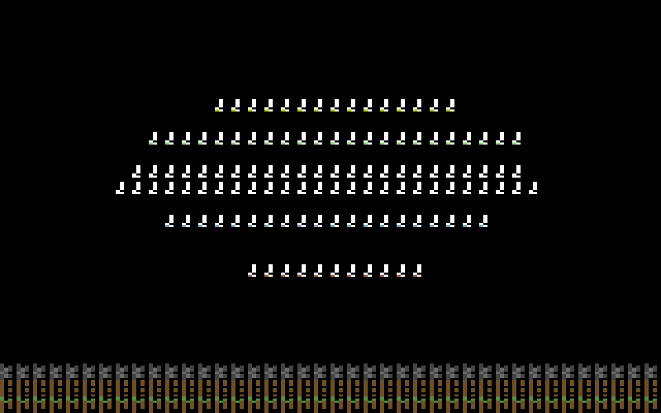

# MINE DEMAKE '64

A C64-style **mine-and-craft** demake (Minecraft / Terraria style) written in
**microScript 2.0**, designed to run on [microStudio](https://microstudio.dev).



## The look (aesthetics checklist)

- **Exact VIC-II palette** — all 16 colors use the measured "Pepto" PAL hex
  values, including *both* browns (`#6F4F25`, `#433900`) and *all three*
  grays (`#444444`, `#6C6C6C`, `#959595`). The headless test suite asserts
  that no other color is ever drawn.
- **8×8 char cells everywhere** — the virtual screen is a fixed **320×200**
  pixel / **40×25** cell framebuffer, scaled up by microStudio's canvas with
  nearest-neighbor sampling (`pixelated` rendering is the default there).
- **One charset look** — every tile, item, creature and letter is a glyph of
  one **256-glyph multicolor char ROM**: 4×8 *double-wide* pixels per cell,
  exactly like a C64 multicolor charset. Each cell = **2 free colors + a
  common background** (per-cell "color RAM"), like the real machine.
- **Two layers like real hardware** — world/sky cells draw their ink-0 pixels
  with the cell background color; entity/HUD glyphs are *hardware-sprite-like*
  overlays where ink-0 is transparent.

## Play

| Key | Action |
|-----|--------|
| Arrows / WASD | move (UP = jump) |
| X (hold) | mine the tile you face (UP/DOWN to aim up/down) |
| Z | place the selected item |
| C | crafting menu (SPACE = craft) |
| 1-8 / E / Q | select hotbar slot |
| SPACE / ENTER | start / restart |

Mine wood → craft **planks** → **sticks** → a **crafting table** → place it →
craft **picks** (wood/stone/iron) to dig deeper for coal, iron, gold and
diamond. Watch out for lava. Torches light the caves (there is a real
per-tile light propagation engine).

## Run it on microStudio

The repository mirrors a microStudio project folder:

```
ms/        microScript sources (loaded in alphabetical order)
sprites/   charrom.png - the editable charset sprite sheet
docs/      previews + screenshots
test/      headless Node test-suite (not needed to play)
tools/     charset generator + headless microScript runner
vendor/    vendored microStudio v2 engine files (for the test harness only)
```

To play on microStudio:

1. Create a new project on [microstudio.dev](https://microstudio.dev)
   (language: **microScript 2.0**).
2. For each file in `ms/`, create a source file with the same name in the
   project and paste the content (or use microStudio's *Import project* if
   you have a zip of this layout).
3. Upload `sprites/charrom.png` as a sprite named **`charrom`** in the
   project's sprite editor.
4. Press *Play*.

## Editing the art & blocks (designed for microStudio)

- **Edit sprites/blocks without touching code**: open the sprite
  **`charrom`** (128×128 px) in microStudio's sprite editor. It is a 16×16
  grid of 8×8 cells; cell *N* (in reading order) is glyph *N*. Draw with
  exactly these four role colors for the inks:
  `#000000` = background, `#FFFFFF` = highlight, `#68372B` = accent color,
  `#70A4B2` = main color. The game loads the sprite at startup
  (`loadCharsetFromSprite`) and converts it to the char ROM — every
  background color you use is just a palette entry, all still VIC-II.
- **Add a block**: add one `tiledef(object ... end)` entry in
  `ms/2_tiles.ms` (pick a glyph from the char ROM and its colors), and — if
  it's new art — draw the glyph at a free index. The world generator,
  renderer, mining and HUD pick it up automatically from the tile table.
- **Add a recipe**: one `recipedef(...)` line in `ms/5_game.ms`.
- **Re-tune the world**: all terrain constants (cave noise, ore counts,
  tree density) are named values in `ms/3_world.ms`.

## Tests (headless, no browser)

The game is fully verifiable outside the browser with the vendored
microScript v2 engine (see `vendor/microscript-v2/`):

```bash
node test/charset.js    # glyph blitting regression tests (solid/mixed/full-width cells)
node test/loadorder.js  # game must work in ANY source-file load order (microStudio loads files in network-arrival order!)
node test/gameplay.js   # full gameplay scenario: mine, craft, place, light, die, restart
node test/play.js       # playthrough + PNG snapshots + palette assertion
python3 tools/genchars.py && python3 tools/preview_glyphs.py   # regenerate charset + previews
```

`test/play.js` renders actual frames to `test/snapshots/*.png` so you can
look at the game without opening a browser.

## Engine notes (microScript 2.0)

Findings verified against the real engine while building this game are in
[docs/lessons-learned-microscript.md](docs/lessons-learned-microscript.md).
The two biggest ones that shaped this codebase:

- **Closures cannot write outer function locals** (writes land in a private
  copy). The renderer therefore keeps its run-merging state in globals
  (`BRUN_*`).
- **`0 == null` is true** in the VM. Default-value checks like
  `if def.hard == null` silently clobber `hard = 0`; all data tables here
  set every field explicitly instead.

## License

Game code and art in this repository: see `LICENSE`. The vendored engine
files under `vendor/microscript-v2/` are from
[microStudio](https://github.com/pmgl/microstudio) and covered by its
license (`vendor/microscript-v2/LICENSE`).
